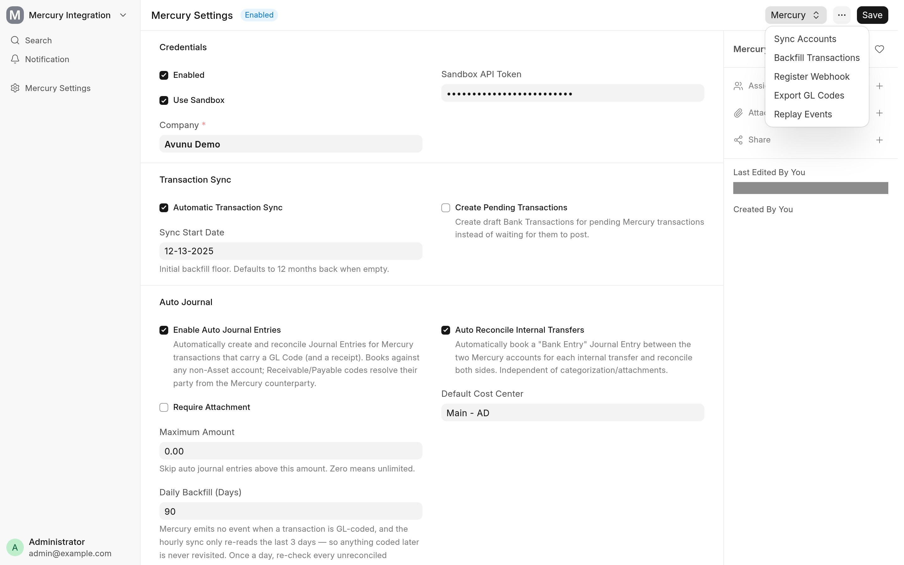

<!-- Copyright (c) 2026, Avunu LLC and contributors
For license information, please see license.txt-->

<!-- frappe-nix:begin header -->

<div align="center">


# Mercury Banking for ERPNext

Mercury bank sync, ACH payouts, invoicing and GL coding for ERPNext

[](https://github.com/Avunu/mercury_banking_integration/actions/workflows/ci.yml)
[](https://github.com/Avunu/mercury_banking_integration/releases)
[](license.txt)
[](https://github.com/frappe/frappe/tree/version-16)
[](https://docs.avunu.net/mercury-banking-integration/)

<picture>
  <source media="(prefers-color-scheme: dark)" srcset="docs/screenshots/settings-dark.webp">
  
</picture>

</div>

<!-- frappe-nix:end header -->

## Overview

A business that banks with [Mercury](https://mercury.com) and keeps its books in ERPNext ends up entering the same money twice. This app connects the two, so ERPNext stays the source of truth: Mercury transactions arrive as Bank Transactions and are reconciled, Payment Requests become Mercury invoices with a pay link, and payroll and supplier payments go out by ACH from ERPNext.

It is for finance teams on ERPNext, payments and HRMS whose bank is Mercury. Each part (bank sync, automatic journal entries, invoicing and payouts) has its own switch in **Mercury Settings**, so you can start with bank sync alone.

Full documentation: [docs.avunu.net/mercury-banking-integration/docs/](https://docs.avunu.net/mercury-banking-integration/docs/).

## Features

- **Bank sync.** _Sync Accounts_ creates the `Mercury` Bank and a Bank Account (with its GL account) for every active Mercury account, or adopts an existing Bank Account with the same account number (or the same name under the `Mercury` bank). Posted transactions are imported hourly as submitted Bank Transactions, and _Backfill Transactions_ imports a chosen number of days. Pending transactions can be kept as drafts. Later changes in Mercury are applied to the Bank Transaction: a new posting date is written to it, and a changed amount or a failed or cancelled transaction cancels it (and re-imports it with the new amount). If it is already reconciled, an amount or status change is left alone and an alert is sent instead.
- **Live updates.** A signed webhook endpoint and a 15-minute poll of Mercury's events API both feed the same handler, and _Replay Events_ runs the last few hours again. Every event is recorded once as an Integration Request.
- **Automatic journal entries.** A transaction that carries a Mercury GL code is booked as a Journal Entry against the ERPNext account of the same name and reconciled with its Bank Transaction. Split transactions get one line per GL code, and a line on a payable or receivable account gets the Employee or Supplier linked to the Mercury counterparty as its party. The transaction's attachments are copied to the Bank Transaction and the Journal Entry. A daily sweep books transactions that were coded after they were synced.
- **Internal transfers.** A transfer between two Mercury accounts is booked as one Bank Entry and reconciled on both accounts.
- **GL code export.** _Export GL Codes_ downloads your expense, income, liability and equity account names as the CSV that Mercury's GL code upload page takes, and opens that page.
- **Invoicing (accounts receivable).** Mercury is registered as a payment gateway. Submitting a Payment Request creates a Mercury invoice and stores its pay link; ERPNext's Payment Request email carries it, and Mercury can also e-mail its own invoice. When the invoice is paid, a Payment Entry is made against a clearing account, and when the deposit reaches the bank, a Journal Entry moves it from clearing to the bank account and reconciles it. Overdue reminders, cancellation and an hourly retry of failed invoice creation are included.
- **Payroll and supplier payouts.** _Pay via Mercury_ on a submitted Payroll Entry previews every salary slip and sends one ACH payment per employee; on a submitted supplier Payment Entry it pays that entry. Payments are either sent at once or queued for a second Mercury user to approve. Their status is tracked on the salary slip or Payment Entry, and the resulting Bank Transactions are reconciled against the payroll Journal Entry or the Payment Entry.
- **Payee onboarding.** Employees and suppliers get a Mercury invite to enter their own bank details, so no bank account numbers are stored in ERPNext. Payees you already pay in Mercury can be matched to their Employee or Supplier from the form or in bulk.
- **Alerts.** Sync, booking, invoicing and payout failures are e-mailed to the addresses in _Alert Recipients_.

<!-- frappe-nix:begin compatibility -->

## Compatibility

| Frappe | Branch       |
| ------ | ------------ |
| v16    | `version-16` |

| Requires                                       | Version            |
| ---------------------------------------------- | ------------------ |
| [erpnext](https://github.com/frappe/erpnext)   | `>=16.0.0,<17.0.0` |
| [payments](https://github.com/frappe/payments) | `>=0.0.1,<1.0.0`   |
| [hrms](https://github.com/frappe/hrms)         | `>=16.0.0,<17.0.0` |

<!-- frappe-nix:end compatibility -->

<!-- frappe-nix:begin installation -->

## Installation

```bash
bench get-app https://github.com/Avunu/mercury_banking_integration --branch version-16
bench --site <site> install-app mercury_banking_integration
```

<!-- frappe-nix:end installation -->

The app requires ERPNext, payments and HRMS on the same site.

## Configuration

Open **Mercury Settings**. A System Manager or Accounts Manager can edit it; **Register Webhook** and **Replay Events** are for a System Manager only.

1. Set the **Company** and an **API Token** (or tick **Use Sandbox** and set a **Sandbox API Token**), then tick **Enabled**. Saving checks the token against Mercury.
2. **Mercury → Sync Accounts** creates or adopts the Bank Accounts. The company needs a Bank group account in its chart of accounts.
3. **Mercury → Register Webhook** (production only; Mercury's sandbox has no webhooks). Without it the 15-minute poll still picks up every event.
4. **Mercury → Backfill Transactions** imports past transactions. Tick **Automatic Transaction Sync** for the hourly import.
5. Turn on the parts you want: **Enable Auto Journal Entries** (then **Mercury → Export GL Codes** and upload the file in Mercury), **Enable AR Gateway** and **Enable Payouts**, and set **Alert Recipients**.

Which Mercury token you need:

- A read-only token is enough for bank sync, automatic journal entries and invoice polling.
- Creating invoices needs a read-write or custom-scoped token.
- **Direct Send** needs a read-write token and the server's fixed outgoing IP address on Mercury's allow list. **Request Approval** needs neither, but a second Mercury user approves each payment in Mercury.

Every setting is described in [docs/configuration.md](docs/configuration.md), and each feature has its own page: [bank sync](docs/bank-sync.md), [automatic journal entries](docs/auto-journal.md), [invoicing](docs/invoicing.md) and [payouts](docs/payouts.md).

## How It Works

- **Mercury API client.** `mercury_banking_integration/client/` is a typed client for Mercury's API that does not import Frappe. It retries on 408, 429 and 5xx responses, honours `Retry-After`, follows cursor pagination and sends idempotency keys.
- **One DocType.** The app adds only **Mercury Settings** (a Single). Mercury ids and payout state are kept in read-only custom fields on Bank Account, Customer, Employee, Supplier, Payment Request, Payment Entry and Salary Slip; the Mercury transaction id goes in the standard `Bank Transaction.transaction_id`.
- **Events.** The webhook checks the `Mercury-Signature` HMAC, records the event once as an Integration Request and returns at once; a background job does the work. The 15-minute poll and _Replay Events_ go through the same path, and handlers always fetch the transaction from Mercury again.
- **Bookkeeping.** Journal Entries carry the Mercury transaction or invoice id in `cheque_no`, which is how the app knows a transaction is already booked. Reconciliation uses ERPNext's own `reconcile_vouchers`.

The design is described in [docs/development/architecture.md](docs/development/architecture.md), and the scheduled jobs and endpoints in [docs/configuration.md](docs/configuration.md#what-the-app-adds-to-your-site).

## Limitations

- **GL coding sends no event.** Mercury's transaction events do not cover GL codes, and the hourly sync re-reads only the last 3 days. A transaction coded later is booked by the daily sweep, dated on the transaction's date, so a long backlog can post into a closed period.
- **Attachments are copied only with an automatic journal entry.**
- **US dollars only**, for one company.
- **No ACH pulls.** Mercury cannot debit a customer's account, so the customer pays from the pay link (with reminders when overdue).
- **Two invoice emails with Mercury as sender.** ERPNext sends its own Payment Request email on submit whatever the gateway answers, so **Invoice Email Sender** set to Mercury means the customer gets both.
- **Mercury's 24-hour duplicate rule.** Mercury refuses a payment to the same payee, from the same account, for the same amount within 24 hours, whatever the idempotency key.
- **Card payments are matched by estimate.** Leave **Accept Credit Card** off until you have checked a real settlement.

The full list, and the errors the app raises with their fixes, are in [docs/troubleshooting.md](docs/troubleshooting.md).

<!-- frappe-nix:begin support -->

## Support

- Documentation: [docs.avunu.net/mercury-banking-integration/](https://docs.avunu.net/mercury-banking-integration/)
- Bug reports and questions: [GitHub issues](https://github.com/Avunu/mercury_banking_integration/issues)
- E-mail: <mail@avu.nu>

<!-- frappe-nix:end support -->

<!-- frappe-nix:begin development -->

## Development

```bash
nix develop        # or: direnv allow
prek install       # the git hooks CI runs
frappe-test        # the tests, the way CI runs them
```

The managed files, checks and release flow are described in the [app standards documentation](https://docs.avunu.net/frappe-nix/docs/app-standards/).

<!-- frappe-nix:end development -->

The test suite, CI and the Plaid and GoCardless migration helpers are described in [docs/development/README.md](docs/development/README.md).

<!-- frappe-nix:begin license -->

## License

MIT, Copyright (c) 2026–present Avunu LLC → [license.txt](license.txt)

<!-- frappe-nix:end license -->
