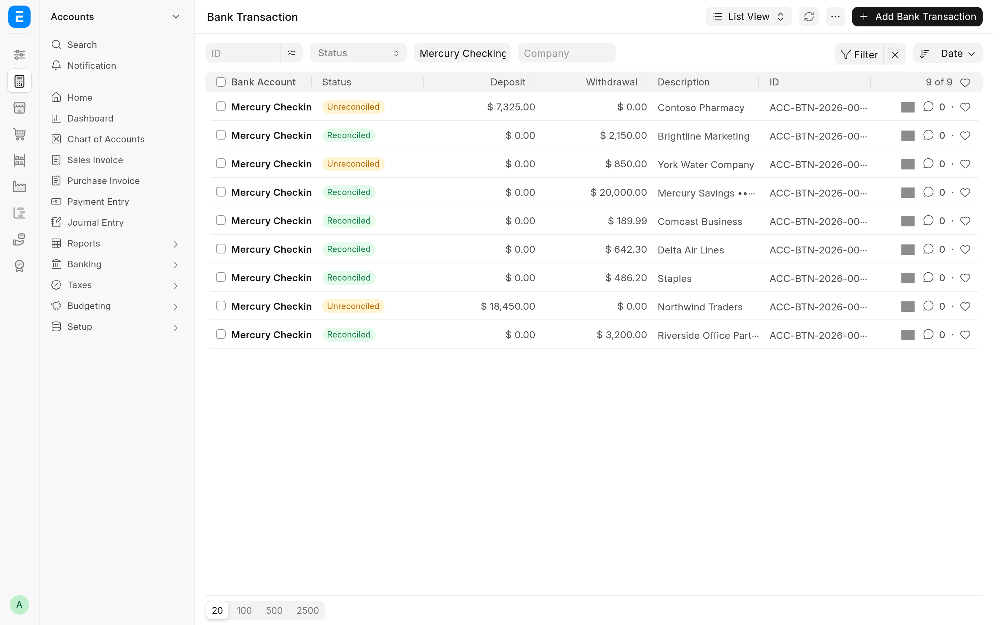

A business that banks with [Mercury](https://mercury.com) and keeps its books in ERPNext ends up entering the same money twice. Mercury Banking for ERPNext connects the two so that ERPNext stays the source of truth. Mercury transactions arrive as Bank Transactions and are reconciled, GL-coded transactions are booked as Journal Entries, Payment Requests become Mercury invoices with a pay link, and payroll and supplier payments go out by ACH from ERPNext.

It is for finance teams on ERPNext, payments and HRMS whose bank is Mercury. Each part has its own switch in **Mercury Settings**, so you can start with bank sync alone. It runs on Frappe v16 and is free software under the [MIT licence](../license.txt).

## What you get

### Bank sync

**Sync Accounts** turns every active Mercury account into an ERPNext Bank Account, or adopts the Bank Account you already have for it. Posted transactions are imported every hour as submitted Bank Transactions, and a signed webhook plus a 15-minute poll of Mercury's events keep them up to date when Mercury changes them. See [Bank sync](bank-sync.md).

### Automatic journal entries

A transaction you give a GL code in Mercury is booked as a Journal Entry against the ERPNext account of the same name, with its receipts attached, and reconciled with its Bank Transaction. A transfer between two of your Mercury accounts becomes one Bank Entry, reconciled on both sides. See [Automatic journal entries](auto-journal.md).

### Invoicing

Mercury is registered as a payment gateway. Submitting a Payment Request creates a Mercury invoice with a pay link, a paid invoice becomes a Payment Entry, and the deposit is booked from a clearing account when it reaches the bank. Overdue customers get reminders. See [Invoicing](invoicing.md).

### Payroll and supplier payouts

**Pay via Mercury** on a Payroll Entry or a supplier Payment Entry sends ACH payments, either at once or for a second Mercury user to approve, and reconciles them when they land. Payees enter their own bank details through a Mercury invite, so no account numbers are stored in ERPNext. See [Payouts](payouts.md).

## Where to start

| You are                                        | Read                                                                                                           |
| ---------------------------------------------- | -------------------------------------------------------------------------------------------------------------- |
| An accountant reconciling the Mercury accounts | [Bank sync](bank-sync.md), then [Automatic journal entries](auto-journal.md)                                   |
| Billing customers through Mercury              | [Invoicing](invoicing.md)                                                                                      |
| Running payroll or paying suppliers            | [Payouts](payouts.md)                                                                                          |
| The administrator setting it up                | [Install and upgrade](install.md), [Configuration](configuration.md) and [Troubleshooting](troubleshooting.md) |
| A developer changing the app                   | [Development](development/README.md) and [How it works](development/architecture.md)                           |

## Requirements

- A bench with Frappe v16. The app declares `frappe >=16.0.0,<17.0.0`.
- ERPNext (`>=16.0.0,<17.0.0`), payments (`>=0.0.1,<1.0.0`) and HRMS (`>=16.0.0,<17.0.0`) on the same site, installed before this app. All three are required apps.
- A Mercury account and an API token. Which token you need depends on the parts you use: see [Mercury API tokens](configuration.md#mercury-api-tokens).
- US dollars. Bank Transactions are created in USD, the invoicing gateway accepts only USD, and automatic journal entries post without exchange rates.

> [!NOTE]
> These pages describe the code in the repository. Where a statement depends on ERPNext's own behaviour, the page says so and names the version it was checked against (Frappe 16 and ERPNext 16.51).

## Source and changes

The source is at [github.com/Avunu/mercury_banking_integration](https://github.com/Avunu/mercury_banking_integration). Each release is listed on the [GitHub releases page](https://github.com/Avunu/mercury_banking_integration/releases), and the [changelog](../CHANGELOG.md) collects the release notes.
