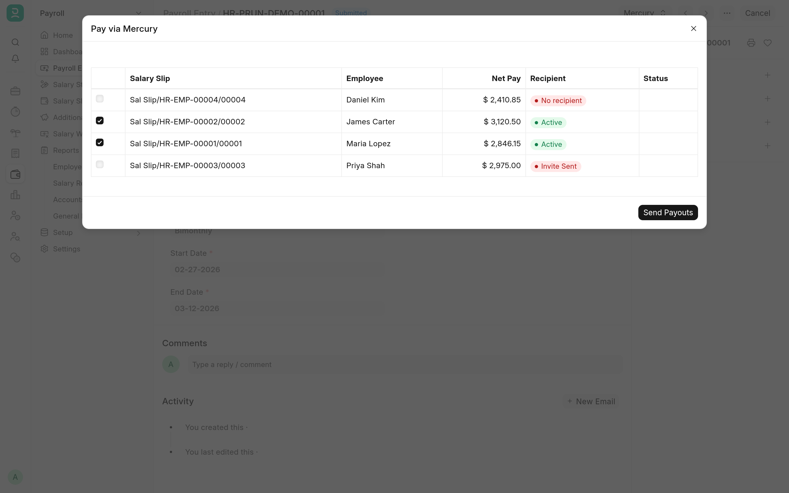

Payouts send ACH payments from Mercury for documents you already have in ERPNext: the salary slips of a Payroll Entry, or a supplier Payment Entry. Nothing is sent when you submit those documents. Someone presses **Pay via Mercury**, sees what will be paid, and confirms. Each payment's progress is recorded on its document, and the Bank Transaction it produces is reconciled for you.

## Before you start

- **Enable Payouts** is ticked in **Mercury Settings**, and the **Payroll Funding Bank Account** and **Vendor Funding Bank Account** are Mercury Bank Accounts (they have been through **Sync Accounts**). See [Configuration](configuration.md#payouts).
- Choose the **Payout Mode**:
  - `Request Approval` (the default) creates each payment in Mercury as a request that a second Mercury user approves. It works with any token.
  - `Direct Send` sends each payment at once. It needs a read-write token and your server's fixed outgoing IP address on Mercury's allow list.
- Each payee is an active Mercury recipient, as below.

## Onboard payees

The **Mercury** menu on an Employee or a Supplier has up to four buttons, depending on the payee's state. **Mercury Recipient Status** in the **Mercury Direct Deposit** section (Employee) or **Mercury Payments** section (Supplier) shows where the payee stands.

| Button                          | Shown when                                  | What it does                                                                                                                                                                                                                                                                    |
| ------------------------------- | ------------------------------------------- | ------------------------------------------------------------------------------------------------------------------------------------------------------------------------------------------------------------------------------------------------------------------------------- |
| **Send Mercury Invite**         | The status is not `Active`                  | After you confirm, Mercury emails the payee a secure link to enter their own bank details. The status becomes `Invite Sent`. The email goes to the Employee's **Preferred Email**, **Company Email** or **Personal Email** (the first one set), or the Supplier's **Email ID**. |
| **Match Mercury Contact**       | The payee has no **Mercury Recipient ID**   | Lists the active Mercury contacts that no Employee or Supplier claims yet, with a ★ on the ones with the same email or name. Pick one and click **Match**; no invite is needed.                                                                                                 |
| **Refresh from Mercury**        | The payee has a recipient or an open invite | Reads the payee's state from Mercury and shows it, with the last four digits of the bank account once there is one.                                                                                                                                                             |
| **Enter Bank Details Directly** | The status is not `Active`                  | Opens **Create Mercury Recipient**, where you enter the **Routing Number**, **Account Number** and **Account Type** and click **Create Recipient**. The details go straight to Mercury and are not stored in ERPNext.                                                           |

Once a day the app checks open invites: a completed invite makes the payee `Active`, and an expired one clears the status so you can send a new invite. **Refresh from Mercury** does the same at once.

### Match many payees at once

If you already pay people in Mercury, link them in bulk from the bench directory. The command is a dry run that reports what it would link; repeat it with `'dry_run': False` to write the links. Use `'party_type': 'Supplier'` for suppliers.

```bash
bench --site <SITE_NAME> execute mercury_banking_integration.payouts.recipients.link_existing_recipients --kwargs "{'party_type': 'Employee'}"
```

It matches each Employee or Supplier that has no recipient yet to an active Mercury contact by email, or else by name, and links them only when one record and one contact pair up. Anything else is reported as ambiguous or unmatched and left alone. Inactive Employees and disabled Suppliers are skipped unless you pass `'include_inactive_parties': True`.

## Pay a payroll run

1. Submit the Payroll Entry and its salary slips as usual.
2. Choose **Mercury → Pay via Mercury**. The preview lists every submitted salary slip with its **Net Pay**, the employee's **Recipient** state and any payout **Status**.
3. The slips that can be paid are ticked. A slip cannot be ticked when its net pay is zero, its employee is not an `Active` recipient, or it already has a payout in progress or reconciled. A red note warns when the same amount went to the same employee in the last 24 hours, which Mercury refuses.
4. Untick any slip you want to hold back, click **Send Payouts** and confirm.



The payments go out in the background, one per salary slip, from the **Payroll Funding Bank Account**. A progress bar shows each slip as it is sent. At the end an alert and a comment on the Payroll Entry give the count sent, skipped and failed, and failures are emailed to the **Alert Recipients**.

Each employee is paid their **Net Pay** to the cent. The slip's **Rounded Total** is never used, because it is rounded to whole units and would pay the wrong amount.

To have the payments reconciled, use the Payroll Entry's **Make Bank Entry** as usual, from the **Payroll Funding Bank Account**. Each employee's payment lands as its own Bank Transaction and is reconciled against that one Journal Entry, which clears when every payment has landed. If a payment lands before the bank entry exists, a daily job reconciles it later.

A salary slip cannot be cancelled while its payout is in progress.

## Pay a supplier

1. Submit a Payment Entry of **Payment Type** Pay to a Supplier.
2. Choose **Mercury → Pay via Mercury** and confirm the amount and payee.

The button is shown while the Payment Entry has no **Clearance Date** and no payout in progress. The **Paid Amount** is sent from the **Vendor Funding Bank Account**. If the Payment Entry's **Company Bank Account** is a different account, a note says so; the money still leaves the vendor funding account. In `Direct Send` mode an empty **Cheque/Reference No** is filled with the Mercury transaction id.

When the payment's Bank Transaction is submitted, it is reconciled with the Payment Entry.

## Payout statuses

**Mercury Payment Status** on the Salary Slip or Payment Entry follows the payment:

| Status                  | Meaning                                                                                                                  |
| ----------------------- | ------------------------------------------------------------------------------------------------------------------------ |
| `Pending Approval`      | Waiting for a second Mercury user to approve it (`Request Approval` mode).                                               |
| `Sent`                  | Mercury has the payment.                                                                                                 |
| `Posted`                | Mercury has posted the payment.                                                                                          |
| `Reconciled`            | Its Bank Transaction is reconciled with the Payment Entry or the payroll Journal Entry.                                  |
| `Failed`                | The payment failed or was cancelled, reversed or blocked in Mercury, or the payee had no active recipient. Pay it again. |
| `Rejected`, `Cancelled` | The approval request was rejected or cancelled in Mercury. Pay it again if needed.                                       |
| `Blocked - Duplicate`   | Mercury refused it as a duplicate (see below).                                                                           |

Approval requests are checked every 15 minutes. Once approved, the payment arrives through Mercury's events and the status moves on to `Sent` and `Posted`. Failures, rejections and cancellations are emailed to the **Alert Recipients**.

Each attempt is logged as an Integration Request with the **Service** `Mercury`, the **Request Description** `Payout` and a **Request ID** made of the document name and the attempt number. That id is also the idempotency key Mercury receives, so a retried request never pays twice: if Mercury says it has already seen it, the app adopts the original payment.

### Mercury's 24-hour duplicate rule

Mercury refuses a payment to the same payee, from the same account, for the same amount within 24 hours, even with a new idempotency key. The payroll preview warns about it. A document that Mercury refused this way gets `Blocked - Duplicate`, and **Pay via Mercury** turns a new attempt away until 24 hours have passed since the last one.

## Related

- [Configuration](configuration.md#payouts) for the settings and the roles that may pay.
- [Troubleshooting](troubleshooting.md) for the errors payouts can raise.
